# claude-mods

Mods for [Claude Code](https://claude.com/claude-code): live panes, bands above the prompt, status lines, toasts and
hooks, each one a small plugin you install with a single line. This repository is one marketplace; every mod lives in its
own folder under [`plugins/`](plugins).

## Mods

| Mod | What it does | Install |
| --- | --- | --- |
| [**live-status**](plugins/live-status) | A live monitor above the prompt: model, effort, context, 5h/7d usage limits, cost, task progress and a subagents panel. Responsive, light and dark. | `/plugin install live-status --marketplace fanoisme/claude-mods` |



More will land here. Each mod has its own README with screenshots, commands and options.

## Install a mod

In a Claude Code terminal session, one line per mod:

```
/plugin install <mod> --marketplace fanoisme/claude-mods
```

Answer `y` to add the marketplace the first time, then choose the **user** scope. The mod is active right away and in
every session you start afterwards. Using the Claude desktop app? Install from a terminal once at the user scope, and the
Code tab loads it too (the `/plugin` command itself is a terminal command).

Browse everything in the marketplace with `/plugin marketplace add fanoisme/claude-mods`, then `/plugin`.

To try a mod without installing it, clone the repo and point Claude Code at its folder:

```
git clone https://github.com/fanoisme/claude-mods
claude --plugin-dir ./claude-mods/plugins/live-status
```

Remove one with `/plugin uninstall <mod>`.

## Add a mod to this repo

Every mod is a folder under `plugins/` with three files and an optional fourth:

```
plugins/<mod>/
  .claude-plugin/plugin.json   name, version, description (and "types" if the mod keeps state)
  hooks/hooks.json             { "modules": ["./register.tsx"] }
  hooks/register.tsx           export const register: Register = (on, options) => { ... }
  types/index.d.ts             only when the mod stores values in $.state
  README.md                    what it is, a screenshot, commands, options
```

The quickest start is the [`template/hello-mod`](template/hello-mod) folder:

```
cp -r template/hello-mod plugins/my-mod    # then rename "hello-mod" inside plugin.json
```

Then register it in [`.claude-plugin/marketplace.json`](.claude-plugin/marketplace.json):

```json
{ "name": "my-mod", "source": "./plugins/my-mod", "description": "One line.", "version": "0.1.0", "category": "mod" }
```

Check everything before you push:

```
./scripts/validate.sh           # validates the marketplace and every mod
```

Mods are written against the Claude Code mod API; while a mod loads, Claude Code writes the API's types into the mod's
`.claude-plugin/types/` (git-ignored), so `npx -p typescript tsc -p plugins/<mod> --noEmit` type-checks it.

## License

MIT, see [LICENSE](LICENSE).
