<p align="center"></p>

# claude-mods

Small add-ons for [Claude Code](https://claude.com/claude-code): live panes and bands above the prompt, status lines,
toasts and hooks. Each one is a plugin you install with a single line, and this repository is the marketplace they come
from. Every mod lives in its own folder under [`plugins/`](plugins).

## Mods

| Mod | What it does | Install |
| --- | --- | --- |
| [live-status](plugins/live-status) | A live monitor above the prompt. See which model and effort you are on, how full the context window is, where the 5-hour and 7-day limits stand, what the session has cost so far, how the current task is going, plus a panel for your subagents. It follows your light or dark theme and stacks down to fit narrow windows. | `/plugin install live-status --marketplace fanoisme/claude-mods` |


More will land here. Every mod has its own README with screenshots, commands and options.

## Install a mod

One line in a Claude Code terminal session:

```
/plugin install <mod> --marketplace fanoisme/claude-mods
```

The first time, answer `y` to add the marketplace, then pick the user scope. That's it: the mod is active right away and
in every session you start afterwards. Using the Claude desktop app? Install once from a terminal and the Code tab loads
the mod too (the `/plugin` command itself is a terminal command).

To browse the whole marketplace at once: `/plugin marketplace add fanoisme/claude-mods`, then `/plugin`.

To try a mod without installing it, clone the repo and point Claude Code at its folder:

```
git clone https://github.com/fanoisme/claude-mods
claude --plugin-dir ./claude-mods/plugins/live-status
```

Remove one with `/plugin uninstall <mod>`.

## Add a mod to this repo

A mod is a folder under `plugins/` with a handful of small files:

```
plugins/<mod>/
  .claude-plugin/plugin.json   name, version, description (and "types" if the mod keeps state)
  hooks/hooks.json             { "modules": ["./register.tsx"] }
  hooks/register.tsx           export const register: Register = (on, options) => { ... }
  types/index.d.ts             only when the mod stores values in $.state
  README.md                    what it is, a screenshot, commands, options
```

The quickest start is the [`template/hello-mod`](template/hello-mod) folder:

```
cp -r template/hello-mod plugins/my-mod    # then rename "hello-mod" inside plugin.json
```

Then register it in [`.claude-plugin/marketplace.json`](.claude-plugin/marketplace.json):

```json
{ "name": "my-mod", "source": "./plugins/my-mod", "description": "One line.", "version": "0.1.0", "category": "mod" }
```

Before you push, check everything:

```
./scripts/validate.sh           # validates the marketplace and every mod
```

Mods are written against the Claude Code mod API. While a mod loads, Claude Code writes the API's types into the mod's
`.claude-plugin/types/` (git-ignored), so `npx -p typescript tsc -p plugins/<mod> --noEmit` type-checks it.

## License

MIT, see [LICENSE](LICENSE).
