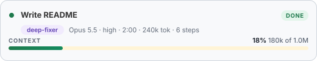

# live-status

> Part of [claude-mods](../..), a collection of Claude Code mods.

A live monitor for [Claude Code](https://claude.com/claude-code), drawn above the prompt. One responsive card shows what
the session is doing right now: **model and effort, context, 5-hour and 7-day usage limits, cost, the task in
progress, and your subagents.** A matching panel lists every subagent with its own context bar.



<details>
<summary>More screenshots</summary>

Idle, light and dark follow your system theme:



A narrow window stacks the card and lists subagents inline, so nothing is lost when there is no room for the panel:



The agents panel (`/monitor`, or `/agents-live`):





</details>

## Install

In a Claude Code terminal session:

```
/plugin install live-status --marketplace fanoisme/claude-mods
```

Answer `y` to add the marketplace, then pick the **user** scope. The mod is active at once and in every session you start
afterwards. If you use the Claude desktop app, install it once from a terminal at the user scope: the Code tab loads it
too (the `/plugin` command itself is a terminal command).

Prefer to try it first without installing? Clone the repo and run:

```
git clone https://github.com/fanoisme/claude-mods
claude --plugin-dir ./claude-mods/plugins/live-status
```

To remove it: `/plugin uninstall live-status`.

## What you get

| Part | Shows | Updates |
| --- | --- | --- |
| **Model chip** | Model name and effort (`Opus 5.5 · high`) | Every model request |
| **Context** | Fill, tokens used of the window, `HIGH` from 60%, `CRITICAL` from 85% | As the engine reports it, and every 5 s mid-turn |
| **5H / 7D limits** | Usage of each window and when it resets | As the engine reports it; countdowns refresh every 15 s when idle |
| **Cost** | Session cost so far | As the engine reports it |
| **Status** | `WORKING` / `IDLE`, elapsed time, steps, tool calls, running agents | Every second while a turn runs |
| **Task bar** | Progress of the task being worked on, `3/5 · 60%`, segmented per step | When the task is reported (see below) |
| **Agents** | One row per subagent, inline when there is no room for the panel | Live |
| **Agents panel** | Summary tiles plus a card per subagent: status, type, model, effort, time, tokens, steps, context bar | Live |
| **Sessions** | Every Claude Code session on the machine, with name, folder, where it runs (desktop / cli), `WORKING` or `IDLE` and when it last changed; this one is marked `THIS`. The band shows `3 sessions · 2 working` | Re-read every 3 s, redrawn only when something changed |

Level is never shown by color alone: the words `HIGH` and `CRITICAL` sit next to the bar. A toast appears once when
context or a limit crosses 85%, and again at 95%.

The 5H and 7D limits are reported only for accounts whose plan has them; without a reading the card says so instead of
guessing. Subagents show **tokens, time and context, not dollars**: the engine reports tokens, not money.

### Commands

| Command | Does |
| --- | --- |
| `/monitor` | Shows or hides everything: the band above the prompt and the agents panel together |
| `/monitor on` · `/monitor off` | Forces it on or off |
| `/agents-live` | Toggles only the agents panel |

The agents panel opens by itself at session start, and the band is on from the first moment.

### Watching other sessions

The side panel lists **every live session on your machine**, so you can keep an eye on a long run in another window:



It reads the small registry entries Claude Code keeps in `~/.claude/sessions/<pid>.json` (name, folder, status, last update).
Nothing else: **no transcripts, no keys, no network.** Entries untouched for 24 hours are treated as dead and hidden. Per-session
model and context are not in that registry, so other sessions show status and activity only; your own session shows the full card.

## Task progress

Nothing can know in advance how big a task is, so the task bar is driven by a small tool the mod adds:
`mcp__live-status__task`. Claude calls it when it starts a multi-step task, after each step, and when it is done. If it
is never called, the bar falls back to **subagents finished out of subagents started**, and with neither the row stays
hidden and the card stays compact.

To have Claude report progress on its own, add this to your `CLAUDE.md`:

```markdown
## Progress
For any task with three or more steps, report progress to the live monitor with the `mcp__live-status__task` tool:
call it once at the start (title, total), after each finished step (done, current = the next step in a few words),
and once with finished: true at the end.
```

## Responsive by design

| Window | What changes |
| --- | --- |
| Wide | One row of model, three gauges and the task bar; the agents panel docks beside the transcript |
| Under 520 px | The card stacks into two rows of gauges |
| No room for the panel (under 144 columns, or the panel is closed) | Up to three subagents are listed inline in the band, two when very narrow |
| Terminal | The same figures as colored text rows, no images |

Motion is limited to a slow sheen on the context and task bars and a travelling highlight on the bottom rail, only while
a turn is running. It stops under `prefers-reduced-motion`, and light and dark follow the system theme.

## Customize

All colors and sizes are plain constants at the top of [`hooks/register.tsx`](hooks/register.tsx): the `CSS` string for
the card and lozenges, the `<linearGradient>` stops for the bars, and `tone()` for the terminal palette. Edit, then
reinstall or reload.

## Develop

```
git clone https://github.com/fanoisme/claude-mods
cd claude-mods
claude --plugin-dir ./plugins/live-status       # loads the mod from the folder
claude plugin validate ./plugins/live-status    # manifest + hooks check
npx -p typescript tsc -p ./plugins/live-status --noEmit   # after the mod has loaded once
```

While a mod loads, Claude Code writes its API types into `.claude-plugin/types/`, which is what `tsc` reads (and why that
folder is git-ignored). The mod keeps its values in `$.state`, declared in [`types/index.d.ts`](types/index.d.ts).

## Compatibility

Written against the Claude Code mod API of build 2.1.293 (`session.measure`, `turn.step`, `agent.spawn`, `ui.render`).
The desktop app draws the card as SVG; the terminal draws text. If a later build renames an event, `claude plugin validate`
will say which one.

## License

MIT, see the repository [LICENSE](../../LICENSE).
